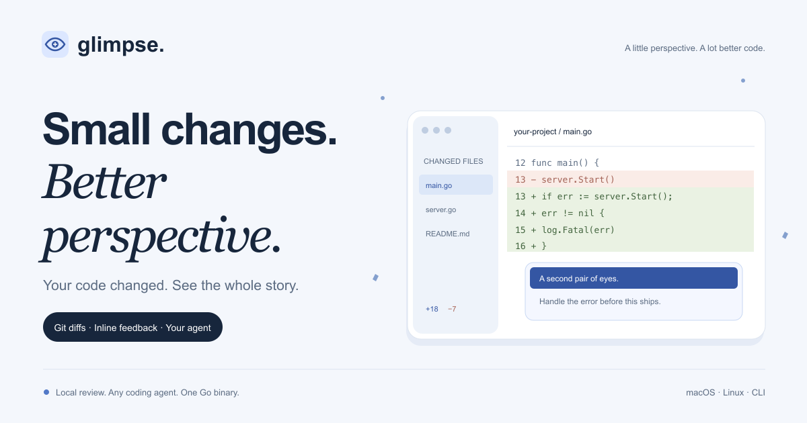

# Glimpse

<p align="center"></p>



[](https://github.com/smeltery/glimpse/actions/workflows/ci.yml)
[](https://github.com/smeltery/glimpse/releases)
[](go.mod)
[](package.json)
[](website/package.json)
[](.flox/env/manifest.toml)
[](LICENSE)

A browser-based Git diff viewer and code review tool. Compare working changes,
branches, commits, or pull requests; leave inline feedback; and hand comments to
your coding agent. One Go binary, with a file tree browser and local HTTP API.

```sh
go install github.com/smeltery/glimpse@latest
cd your-repository
glimpse            # staged and unstaged changes
glimpse main       # compare against main
glimpse tree       # browse the project
```

Requires Git and Go 1.26.1+ to install from source. Prebuilt macOS and Linux
binaries are available in [releases](https://github.com/smeltery/glimpse/releases).

## Documentation

Start in [docs/](docs/index.md):
[installation](docs/index.md), [CLI](docs/cli.md),
[agent and PR workflows](docs/workflows.md), [API](docs/api/index.md),
and [development](docs/development.md).

## Develop

```sh
flox activate
make setup        # frozen Bun install and local hooks
make ci           # the same checks as GitHub Actions
```

The Next.js website lives in `website/` and renders the Markdown in `docs/`.
Run `flox activate --start-services` for its local preview.

[PolyForm Shield license](LICENSE) © 2026 smeltery.
