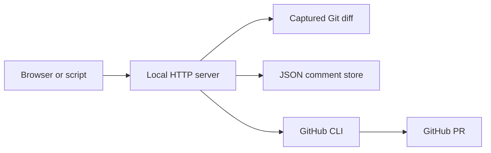

# Glimpse API

The local HTTP API powers the browser viewer. Use it to inspect a captured diff,
read files in tree mode, and manage inline comments from scripts or agents.
Start Glimpse first and use `glimpse list --json` to discover the correct port.

## Base URL

```text
http://localhost:5391
```

This is an unauthenticated local API, not a hosted service. The current server
binds all interfaces and allows cross-origin requests. Keep it on a trusted
machine/network. Routes and error behavior below describe the current implementation.
Errors are plain text; successful responses are JSON. There is no API version prefix.

## Review data

| Method | Path               | Purpose                         |
| ------ | ------------------ | ------------------------------- |
| GET    | `/api/diff`        | [Read a captured diff](diff.md) |
| GET    | `/api/tree`        | [List tree files](tree.md)      |
| GET    | `/api/file?path=…` | [Read a tree file](tree.md)     |

## Comments

| Method | Path                 | Purpose                          |
| ------ | -------------------- | -------------------------------- |
| GET    | `/api/comments`      | [List comments](comments.md)     |
| POST   | `/api/comments`      | [Create a comment](comments.md)  |
| PATCH  | `/api/comments/{id}` | [Resolve a comment](comments.md) |
| DELETE | `/api/comments/{id}` | [Delete a comment](comments.md)  |

## GitHub

| Method | Path           | Purpose                          |
| ------ | -------------- | -------------------------------- |
| POST   | `/api/gh/pull` | [Import PR comments](github.md)  |
| POST   | `/api/gh/push` | [Publish PR comments](github.md) |


