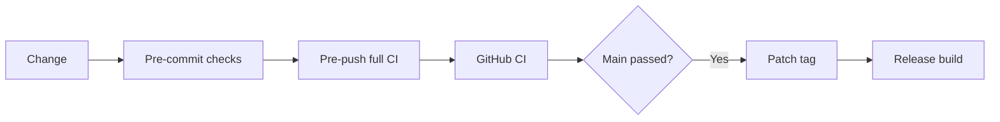

# Development

The Go binary embeds the local viewer in `internal/server/static/`. The separate
Next.js website in `website/` renders the user docs from `docs/` at build time.

## Reproducible environment

Install [Flox](https://flox.dev/docs/install-flox/), then enter the repository:

```sh
flox activate
make setup
make ci
```

The committed Flox manifest and lock provide Go, Bun, Node, Git, Make,
golangci-lint, actionlint, and pre-commit on macOS and Linux. Bun manages the
workspace dependencies with the root `bun.lock`; Node runs Next.js tooling.
`make setup` installs frozen dependencies, Chromium, and both Git hooks.
On Linux, `bunx playwright install --with-deps chromium` installs browser system
libraries too (requires system package installation privileges).

## Commands

| Command                       | Purpose                                                         |
| ----------------------------- | --------------------------------------------------------------- |
| `make build`                  | Build the CLI                                                   |
| `make test`                   | Race-enabled Go tests with coverage                             |
| `make check`                  | Markdown, Mermaid, links, LOC, formatting, types, lint, Actions |
| `make ci`                     | All checks, Go tests/build, website build, browser tests        |
| `bun run format`              | Format authored docs, website, scripts, and workflows           |
| `make website`                | Development website at localhost:3000                           |
| `bun run --cwd website build` | Static production export in `website/out/`                      |

Run `flox activate --start-services` to start the website via Flox services.
Use `flox services status` and `flox services stop website` to manage it.
For a production preview, run `bunx serve website/out -l 3000` after building.
The committed Playwright configuration also starts a static production preview.

## Documentation and assets

Edit Markdown in `docs/`, then update `website/src/lib/catalog.ts` when adding a
page. Relative Markdown links work both on GitHub and in the website.
Mermaid fences render lazily in the browser and are parsed in validation.
The SVG logo and editable social image source live in `website/public/`.
Generate the PNG after editing its SVG with:

```sh
bun -e 'const sharp = require("sharp"); await sharp("website/public/og-image.svg").png().toFile("website/public/og-image.png")'
```

## CI and hooks

GitHub Actions runs `make ci` inside the locked Flox environment on Linux and
macOS. The pre-commit hook runs `make check`; pre-push runs the complete `make ci`.
Failures stop commits/pushes. Both use the same targets as CI.
Coverage must stay at or above 50%; formatting and lint never auto-pass a failure.
Browser checks cover navigation, mobile menus, documentation, copy/search,
accessibility, and invalid routes against the static production export.



## Automatic releases

After successful main-branch CI, auto-release tags the exact tested commit with
the next patch version (starting at v0.1.0) and explicitly dispatches the release
workflow. It skips stale main revisions and refuses non-semantic tags. Existing
tags can be retried through the release workflow's `tag` input.
Releases contain macOS/Linux amd64/arm64 archives and checksums.
Homebrew publishing requires the repository's `HOMEBREW_TAP_TOKEN` secret;
without it, GitHub archives still publish and the tap job is skipped.

## Keep it lean

New source and docs default to 300 lines per file; formatted CSS has a 500-line
budget. Directories allow at most 25 source/doc/config files. Two existing Go
files have explicit frozen limits in `scripts/loc-budgets.json`.
The checker includes untracked source so local hooks catch new oversized files.
Split by responsibility, not arbitrary line counts. Do not compress code to
avoid the budget. Generated assets, dependencies, lockfiles, and Flox state are
excluded. The website uses shared layouts and one Markdown content source.
