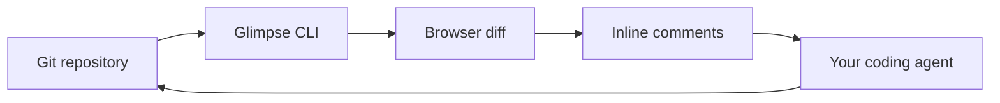

# Getting started

Glimpse turns Git changes into a browser-based review. Inspect split or unified
diffs, leave inline comments, and pass feedback to your coding agent.
The viewer runs from a single Go binary; it does not require a hosted account.

## Install

Install with Go 1.26.1 or newer:

```sh
go install github.com/smeltery/glimpse@latest
```

Or download a macOS or Linux archive for your architecture from
[GitHub releases](https://github.com/smeltery/glimpse/releases).
Extract it and put `glimpse` on your `PATH`.
Git is required. GitHub PR workflows also require an authenticated `gh` CLI.

## Your first review

Run inside a Git repository:

```sh
glimpse
glimpse main
glimpse HEAD~3
glimpse main..feature
```

With no refs, Glimpse combines staged and unstaged changes. Untracked files are
not part of a Git diff. The browser opens automatically; use `--no-open` on a
headless machine. The first available port starts at 5391.



## Next steps

- [CLI reference](cli.md): commands, refs, and flags.
- [Review workflows](workflows.md): agents, project trees, and GitHub PRs.
- [Local API](api/index.md): read diffs and manage review comments.
- [Development](development.md): Flox, Bun, checks, and releases.

## Troubleshooting

Run `glimpse list` to find running instances. A second invocation in the same
repository reuses an existing instance; use `--new` to replace it when you need
a fresh diff. If a port is occupied, choose `--port 5400`.

If `glimpse` is not found after installation, add your Go binary directory
(usually `$(go env GOPATH)/bin`) to `PATH`.
The server currently listens on all network interfaces without authentication.
Use it on a trusted machine/network, not as a public hosted service.
