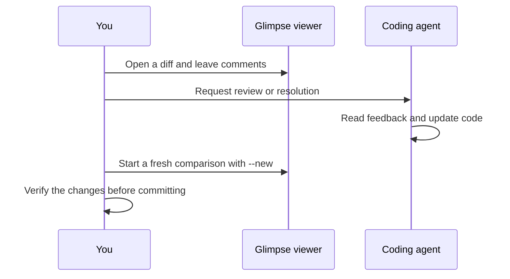

# Review workflows

Use Glimpse to review local changes with a person, a coding agent, or both.

## Agent skills

The repository's `.skills/` directory contains instructions for compatible
agents. Copy the relevant Markdown files to your agent's skill directory,
following that agent's installation convention.

| Skill                   | Task                                              |
| ----------------------- | ------------------------------------------------- |
| `/glimpse-diff`         | Open a working-tree or ref comparison             |
| `/glimpse-review`       | Ask the agent to review and leave inline feedback |
| `/glimpse-resolve`      | Ask the agent to apply open diff feedback         |
| `/glimpse-tree`         | Browse the project without a diff                 |
| `/glimpse-resolve-tree` | Ask the agent to apply tree feedback              |

Skills can be used with Claude Code, Cursor, Codex, and other agents that can
follow the instructions. The built-in `glimpse review` command specifically
invokes the Claude CLI; it is separate from the agent-independent skills.



## Inline feedback

Comments include a file, line, side (`old` or `new`), and severity.
Use `must-fix`, `suggestion`, `nit`, or `question` to communicate priority.
Copy comments from the viewer, or run `glimpse resolve` to print them.
Review the resulting edits before marking feedback resolved.

## Browse the project

```sh
glimpse tree
```

The tree browser shows repository files with syntax highlighting. Leave comments
on files or lines, then use `/glimpse-resolve-tree` with your agent.
Tree comments have their own session store.

## GitHub pull requests

Install GitHub CLI and authenticate with `gh auth login`, then run:

```sh
glimpse https://github.com/owner/repo/pull/123
```

The viewer can pull existing GitHub review comments or push local comments as
PR review comments. Pushing publishes feedback to GitHub using your `gh`
authentication. Inspect the comments before using the push action.
Skills also accept PR URLs.

## Session storage

Instance records and comments live under `~/.local/share/glimpse/`.
Diff comments are keyed by port; tree comments use a `tree-` prefix.
Diff data is captured at startup rather than streamed from a file watcher.
Restart with `--new` to see a fresh comparison after editing files.
